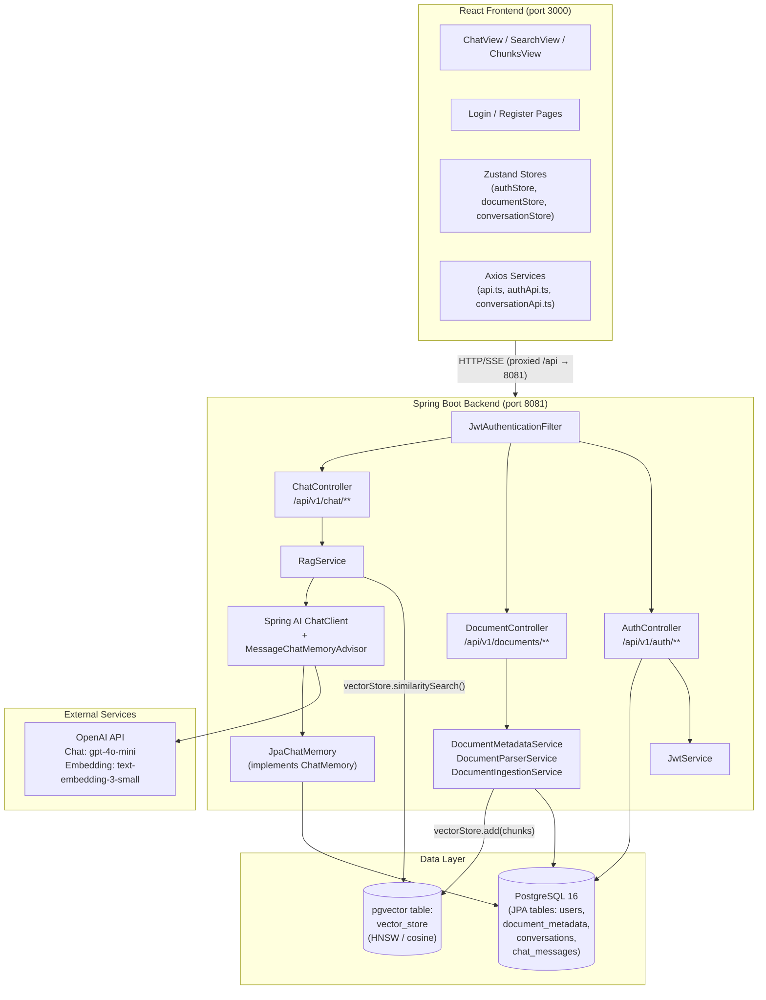
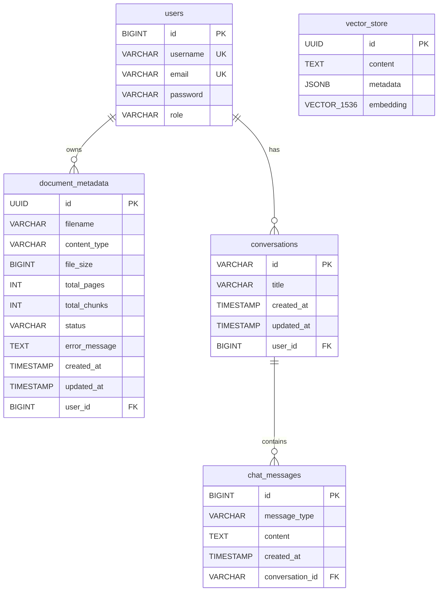

# DocMind — AI Document Intelligence & RAG Platform


DocMind is a full‑stack **Retrieval‑Augmented Generation (RAG)** platform that allows users to upload documents, intelligently extract and index their content, and converse with them through an AI-powered chat interface. It combines semantic vector search with OpenAI language models to deliver context-grounded answers with source citations — all behind a secure, per-user authentication layer.

---

## 📸 Screenshots

> Screenshots from `frontend/screenshots/`

| Chat Interface | Document Upload |
|:-:|:-:|
|  |  |

| Semantic Search | Chunk Viewer |
|:-:|:-:|
|  |  |

---

## ✨ Features

| Feature | Status |
|---------|--------|
| User registration & JWT login | ✅ Implemented |
| Multi-format document upload (PDF, DOCX, TXT, MD, CSV, and more) | ✅ Implemented |
| Dual-parser: Spring AI PDF reader + Apache Tika (generic) | ✅ Implemented |
| Token-aware text chunking via `TokenTextSplitter` | ✅ Implemented |
| OpenAI embedding generation (`text-embedding-3-small`) | ✅ Implemented |
| Vector storage & HNSW ANN search with pgvector | ✅ Implemented |
| Per-user document isolation at the vector level | ✅ Implemented |
| Blocking Q&A with source citations | ✅ Implemented |
| Streaming Q&A via Server-Sent Events (SSE) | ✅ Implemented |
| Semantic similarity search endpoint | ✅ Implemented |
| Persistent, database-backed chat memory (`JpaChatMemory`) | ✅ Implemented |
| Multi-document upload in a single request | ✅ Implemented |
| Document deletion with vector purge | ✅ Implemented |
| Admin role with access to all documents | ✅ Implemented |
| Interactive Swagger UI | ✅ Implemented |
| React SPA with Zustand state management | ✅ Implemented |
| Dark-mode UI with Tailwind CSS v4 | ✅ Implemented |

---

## 🏗️ Architecture

### High-Level Overview



### Request Flow

#### Document Upload
1. Client sends `POST /api/v1/documents/upload` (multipart) with a JWT bearer token.
2. `JwtAuthenticationFilter` validates the token; `User` is set as the Spring Security principal.
3. `DocumentController` delegates to `DocumentMetadataService.uploadAndProcess()`.
4. `DocumentParserService` selects the appropriate parser:
   - **PDF** → `PagePdfDocumentReader` (Spring AI PDF reader, page-aware)
   - **Everything else** → `TikaDocumentReader` (Apache Tika)
5. `DocumentIngestionService.ingest()` runs the chunking + indexing pipeline:
   - Chunks text with `TokenTextSplitter` (configurable chunk size, default 700 tokens).
   - Enriches each chunk's metadata with `documentId`, `userId`, `fileName`, `contentType`, `chunkIndex`, and `pageNumber`.
   - Calls `vectorStore.add(enrichedChunks)` — Spring AI calls the OpenAI embedding API and writes to `vector_store`.
   - Updates `DocumentMetadata` status to `INDEXED`.
6. Returns `DocumentResponseDto` (id, filename, chunks created, status).

#### Q&A (Blocking)
1. Client sends `POST /api/v1/chat/query` with a JSON body.
2. `RagService.askQuestion()` creates or retrieves a `Conversation` row for the given `conversationId`.
3. Calls `retrieveRelevantDocuments()` which builds a `SearchRequest` with:
   - `userId` filter (mandatory, enforced via `FilterExpressionBuilder`)
   - Optional `documentId` filter for single-document scope
   - Configurable `topK` (default 5) and `similarityThreshold` (default 0.0)
4. `vectorStore.similaritySearch()` performs an HNSW cosine-distance ANN query.
5. Retrieved chunks are formatted into a context string `[Source: <filename> | Page: <n>]\n<text>`.
6. `ChatClient` sends the system prompt (with `{doc_context}`) and user question to `gpt-4o-mini`, with `MessageChatMemoryAdvisor` injecting the last 10 messages from `JpaChatMemory`.
7. Returns `ChatResponseDto` (answer, conversationId, citations list, responseTimeMs).

#### Q&A (Streaming)
Same as blocking, except `chatClient.stream().content()` is used and the endpoint returns a `Flux<String>` via `text/event-stream` (SSE). A terminal `[DONE]` token is appended.

---

## 🛠️ Technology Stack

### Backend

| Technology | Version | Role |
|------------|---------|------|
| Java | 21 | Language runtime; uses records, sealed types |
| Spring Boot | 4.1.0 | Application framework (Web MVC, JPA, Validation, Security) |
| Spring AI | 2.0.0 | LLM & vector store abstraction layer |
| `spring-ai-starter-model-openai` | 2.0.0 | OpenAI Chat + Embedding client |
| `spring-ai-starter-vector-store-pgvector` | 2.0.0 | pgvector `VectorStore` implementation |
| `spring-ai-pdf-document-reader` | 2.0.0 | Page-aware PDF parsing (Spring AI / PDFBox) |
| `spring-ai-tika-document-reader` | 2.0.0 | Apache Tika multi-format parser |
| `spring-ai-starter-tool-search-advisor` | 2.0.1 | Tool/search advisor for ChatClient |
| `spring-ai-vector-store-advisor` | 2.0.0 | Vector store advisor |
| Spring Security | (Boot 4.1.0 managed) | Authentication, authorization, CSRF disabled for API |
| JJWT | 0.13.0 | JWT creation, signing, and validation |
| PostgreSQL driver | (Boot managed) | JDBC connectivity |
| Springdoc OpenAPI | 3.1.0 | Swagger UI at `/swagger-ui/index.html` |
| ModelMapper | 3.2.4 | Entity ↔ DTO mapping |
| Lombok | (provided) | Boilerplate reduction (`@Builder`, `@Getter`, etc.) |
| Maven | 3.x | Build and dependency management |

### Frontend

| Technology | Version | Role |
|------------|---------|------|
| React | 19.x | UI framework |
| TypeScript | 6.0 | Static typing |
| Vite | 8.x | Build tool and dev server (port 3000) |
| Tailwind CSS | v4.x | Utility-first CSS via `@tailwindcss/vite` plugin |
| Zustand | 5.x | Lightweight global state management |
| Axios | 1.19 | HTTP client for API calls |
| React Router DOM | 7.x | Client-side routing |
| Framer Motion | 13.x | Animations |
| React Markdown | 10.x | Markdown rendering for AI responses |
| Remark GFM | 4.x | GitHub-Flavored Markdown support |
| Prism.js | 1.30 | Syntax highlighting in code blocks |
| React Dropzone | 20.x | Drag-and-drop file upload |
| React Hot Toast | 2.x | Toast notifications |
| Lucide React | 1.33 | Icon library |
| OXLint | 1.75 | Fast JavaScript/TypeScript linter |

### Infrastructure

| Technology | Role |
|------------|------|
| Docker Compose | Runs `pgvector/pgvector:pg16` PostgreSQL with init SQL |
| PostgreSQL 16 + pgvector | Relational store + ANN vector search |
| OpenAI API | Embedding (`text-embedding-3-small`) + Chat (`gpt-4o-mini`) |

---

## 📁 Project Structure

```
DocMind/
├── docker-compose.yml               # PostgreSQL 16 + pgvector container
├── init.sql                         # DB extensions: vector, uuid-ossp
├── pom.xml                          # Maven build (Spring Boot 4.1.0 parent)
├── mvnw / mvnw.cmd                  # Maven wrapper scripts
│
├── src/
│   ├── main/
│   │   ├── java/com/substring/docmind/
│   │   │   ├── DocmindBackendApplication.java   # Spring Boot entry point
│   │   │   │
│   │   │   ├── config/
│   │   │   │   ├── AppProperties.java           # @ConfigurationProperties prefix="app"
│   │   │   │   ├── CorsConfig.java              # WebMvcConfigurer CORS (from app.cors.*)
│   │   │   │   ├── JwtAuthenticationFilter.java # OncePerRequestFilter – JWT validation
│   │   │   │   ├── ProjectConfig.java           # ChatClient, OpenAPI, ModelMapper beans
│   │   │   │   └── SecurityConfig.java          # SecurityFilterChain, BCrypt, stateless
│   │   │   │
│   │   │   ├── controller/
│   │   │   │   ├── AuthController.java          # POST /api/v1/auth/login, /register
│   │   │   │   ├── ChatController.java          # POST /api/v1/chat/query, /stream, /search/similarity
│   │   │   │   └── DocumentController.java      # POST /upload, /upload-multiple; GET /user, /{id}; DELETE /{id}
│   │   │   │
│   │   │   ├── dto/
│   │   │   │   ├── ApiResponse.java             # Generic wrapper: success, message, data, timestamp
│   │   │   │   ├── ChatRequestDto.java          # question, documentId?, topK?, minSimilarity?, conversationId?
│   │   │   │   ├── ChatResponseDto.java         # answer, conversationId, citations, responseTimeMs
│   │   │   │   ├── CitationDto.java             # documentId, fileName, chunkIndex, pageNumber, snippet, score
│   │   │   │   ├── DocumentMetadataDto.java     # Mapped from DocumentMetadata entity
│   │   │   │   ├── DocumentResponseDto.java     # id, fileName, fileSize, chunksCreated, status, userId
│   │   │   │   ├── LoginRequest.java            # record: username, password
│   │   │   │   ├── LoginResponse.java           # token, UserDto
│   │   │   │   ├── RegisterUserRequest.java     # record: username, email, password
│   │   │   │   ├── SearchRequestDto.java        # query, documentId?, topK?, similaritySearch?
│   │   │   │   ├── SearchResultDto.java         # query, totalMatches, matches: List<CitationDto>
│   │   │   │   └── UserDto.java                 # id, username, email, role
│   │   │   │
│   │   │   ├── entity/
│   │   │   │   ├── ChatMessage.java             # @Entity chat_messages: id, conversation, messageType, content, createdAt
│   │   │   │   ├── Conversation.java            # @Entity conversations: id (String), user, title, timestamps, messages
│   │   │   │   ├── DocumentMetadata.java        # @Entity document_metadata: UUID id, filename, status, user, etc.
│   │   │   │   ├── DocumentStatus.java          # enum: UPLOADING, PROCESSING, INDEXED, FAILED
│   │   │   │   ├── MessageType.java             # enum: USER, ASSISTANT, SYSTEM
│   │   │   │   ├── Role.java                    # enum: USER, ADMIN
│   │   │   │   └── User.java                    # @Entity users: Long id, username, password, role, email
│   │   │   │
│   │   │   ├── exception/
│   │   │   │   ├── DocumentProcessingException.java  # 422 on parse/index failure
│   │   │   │   ├── GlobalExceptionHandler.java       # @RestControllerAdvice
│   │   │   │   └── ResourceNotFoundException.java    # 404 for missing entities
│   │   │   │
│   │   │   ├── repository/
│   │   │   │   ├── ChatMessageRepository.java        # findLastNMessages(conversationId, n), deleteByConversation_Id
│   │   │   │   ├── ConversationRepository.java       # findByIdAndUser(id, user)
│   │   │   │   ├── DocumentMetadataRepo.java         # findByUserOrderByCreatedAtDesc, findAllByOrderByCreatedAtDesc
│   │   │   │   └── UserRepository.java               # findByUsername
│   │   │   │
│   │   │   └── service/
│   │   │       ├── CustomUserDetail.java             # UserDetails adapter for User entity
│   │   │       ├── CustomUserDetailService.java      # UserDetailsService impl
│   │   │       ├── DocumentIngestionService.java     # Chunking → metadata enrichment → vectorStore.add()
│   │   │       ├── DocumentMetadataService.java      # Upload orchestration, CRUD, vector purge on delete
│   │   │       ├── DocumentParserService.java        # PDF → PagePdfDocumentReader; other → TikaDocumentReader
│   │   │       ├── JpaChatMemory.java                # ChatMemory impl backed by chat_messages table (last 10)
│   │   │       ├── JwtService.java                   # Token generation, validation, claim extraction (JJWT)
│   │   │       ├── RagService.java                   # RAG orchestration: retrieve → build context → ChatClient
│   │   │       └── UserService.java                  # User registration with BCrypt
│   │   │
│   │   └── resources/
│   │       ├── application.yaml                # Active profile: dev; server port: 8081
│   │       └── application-dev.yml             # Full dev config (DB, OpenAI, pgvector, JWT, RAG, CORS)
│   │
│   └── test/java/                              # Test directory (scaffold present)
│
├── frontend/
│   ├── screenshots/                            # 4 UI screenshots
│   └── docmind-frontend/
│       ├── index.html
│       ├── vite.config.ts                      # Port 3000; proxy /api → http://localhost:8081
│       ├── package.json
│       ├── tsconfig*.json
│       ├── .oxlintrc.json                      # OXLint config
│       └── src/
│           ├── main.tsx                        # React entry point
│           ├── App.tsx                         # BrowserRouter, routes, Toaster
│           ├── App.css / index.css             # Global styles (dark theme, Tailwind)
│           ├── pages/
│           │   ├── Login.tsx                   # Login form page
│           │   └── Register.tsx               # Registration form page
│           ├── components/
│           │   ├── ChatView.tsx               # Main chat UI with SSE streaming support
│           │   ├── ChatsPanel.tsx             # Conversation list panel
│           │   ├── ChunksView.tsx             # Document chunk inspector
│           │   ├── ErrorBoundary.tsx          # React error boundary
│           │   ├── Navbar.tsx                 # Top navigation bar
│           │   ├── ProtectedRoute.tsx         # Route guard using authStore
│           │   ├── SearchView.tsx             # Semantic similarity search UI
│           │   ├── Sidebar.tsx                # Document list + tab navigation
│           │   └── UploadDialog.tsx           # Drag-and-drop file upload modal
│           ├── services/
│           │   ├── api.ts                     # Axios instance + document/chat/search API calls
│           │   ├── authApi.ts                 # Login, register API calls
│           │   └── conversationApi.ts         # Conversation history API calls
│           ├── store/
│           │   ├── authStore.ts               # Zustand: token, user, login/logout (localStorage)
│           │   ├── conversationStore.ts       # Zustand: conversations, active chat
│           │   └── documentStore.ts           # Zustand: documents, activeTab
│           └── types/                         # TypeScript type definitions
│
└── docs/                                      # Internal design docs (not part of production)
    ├── CHAT_MEMORY_DB_ARCHITECTURE.md
    ├── FRONTEND_BUILD_PROMPT.md
    ├── USER_DOCUMENT_ISOLATION_ANALYSIS.md
    └── prompt.md
```

---

## ⚙️ Prerequisites

| Requirement | Minimum Version | Notes |
|-------------|----------------|-------|
| Java (JDK) | 21 | `java -version` must show 21+ |
| Maven | 3.8+ | Or use the included `mvnw` wrapper |
| Node.js | 18+ | Frontend tooling |
| npm | 9+ | Package manager |
| Docker Desktop | Latest stable | To run PostgreSQL via Docker Compose |
| OpenAI API key | — | Needs access to `gpt-4o-mini` and `text-embedding-3-small` |

---

## 🚀 Getting Started

### Step 1 — Clone the repository

```bash
git clone https://github.com/<your-org>/DocMind.git
cd DocMind
```

### Step 2 — Start the database

```bash
docker-compose up -d
```

This starts a **PostgreSQL 16 container** with the `pgvector` extension, listening on **host port 5434** (mapped to container port 5432).

> **What `init.sql` does:**
> ```sql
> CREATE EXTENSION IF NOT EXISTS vector;
> CREATE EXTENSION IF NOT EXISTS "uuid-ossp";
> ```
> The `vector_store` table is created automatically by Spring AI (`initialize-schema: true`).

Verify the container is healthy:
```bash
docker ps           # status should be "healthy"
docker logs doc-mind-postgres
```

**Docker Compose credentials (default):**
| Setting | Value |
|---------|-------|
| Host | `localhost` |
| Port | `5434` |
| Database | `docmind` |
| Username | `postgres` |
| Password | `postgres` |

### Step 3 — Configure the backend

All configuration lives in `src/main/resources/application-dev.yml`. The file uses environment-variable substitution with fallback defaults:

```yaml
spring:
  datasource:
    url: jdbc:postgresql://${DB_HOST:localhost}:${DB_PORT:5434}/${DB_NAME:docmind}
    username: ${DB_USER:postgres}
    password: ${DB_PASSWORD:postgres}

  ai:
    openai:
      api-key: ${OPENAI_API_KEY:demo-key}   # ← Set this
      chat:
        model: ${OPENAI_CHAT_MODEL:gpt-4o-mini}
        temperature: 0.2
      embedding:
        model: ${OPENAI_EMBEDDING_MODEL:text-embedding-3-small}

    vectorstore:
      pgvector:
        index-type: HNSW
        distance-type: COSINE_DISTANCE
        dimensions: 1536
        table-name: vector_store
        schema-name: public
        initialize-schema: true

  servlet:
    multipart:
      max-file-size: 25MB
      max-request-size: 50MB

app:
  rag:
    chunk-size: 700
    top-k: 5
    similarity-threshold: 0.0
  cors:
    allowed-origins: "*"
    allowed-methods: GET,POST,PUT,DELETE,OPTIONS
    allowed-headers: "*"

jwt:
  secret: ${JWT_SECRET:your-secret-key-here-minimum-32-chars}
  expiration: 3600000     # 1 hour in milliseconds

server:
  port: 8081
```

**Set your OpenAI API key:**

*Linux / macOS:*
```bash
export OPENAI_API_KEY=sk-...
```

*Windows (PowerShell):*
```powershell
$env:OPENAI_API_KEY = "sk-..."
```

Or edit `application-dev.yml` directly and replace `${OPENAI_API_KEY:demo-key}` with your key (**do not commit real keys**).

> **JWT Secret note:** The default fallback secret in the config is a long random string used for development only. In production, always override it with a strong secret via `JWT_SECRET` environment variable.

### Step 4 — Run the backend

*Linux / macOS:*
```bash
./mvnw spring-boot:run
```

*Windows (PowerShell):*
```powershell
.\mvnw.cmd spring-boot:run
```

The backend starts on **http://localhost:8081**.

**Verify the backend:**
```bash
curl http://localhost:8081/v3/api-docs
# Should return the OpenAPI JSON document
```

**Swagger UI:** http://localhost:8081/swagger-ui/index.html

### Step 5 — Run the frontend

```bash
cd frontend/docmind-frontend
npm install
npm run dev
```

The frontend starts on **http://localhost:3000**.

The Vite dev server is pre-configured to proxy all `/api/*` requests to `http://localhost:8081`:
```ts
// vite.config.ts
proxy: {
  '/api': {
    target: 'http://localhost:8081',
    changeOrigin: true,
  },
},
```

**Verify the setup end-to-end:**
1. Open http://localhost:3000
2. Click **Register** — create an account.
3. Log in — you should land on the Dashboard.
4. Click **Upload** — upload a PDF or text file.
5. Once indexed, ask a question in the Chat tab.

---

## 🔄 Features & Workflows

### User Registration & Login

| Step | What happens |
|------|-------------|
| `POST /api/v1/auth/register` | `UserService` hashes the password with BCrypt, saves to `users` table, assigns `Role.USER`. |
| `POST /api/v1/auth/login` | `AuthenticationManager` verifies credentials, `JwtService` generates a signed JWT (HMAC-SHA, 1 hour expiry). |
| All subsequent requests | `JwtAuthenticationFilter` extracts the token from `Authorization: Bearer <token>`, validates it, and sets the `User` entity as the Security principal. |

### Document Ingestion Pipeline

```
Upload file
     │
     ▼
DocumentMetadataService.uploadAndProcess()
     │  ┌─ persist DocumentMetadata (status=UPLOADING)
     │
     ▼
DocumentParserService.parse()
     ├─ .pdf / application/pdf → PagePdfDocumentReader  (page-level Documents)
     └─ everything else        → TikaDocumentReader     (single Document)
     │
     ▼
DocumentIngestionService.ingest()
     │  ┌─ status → PROCESSING
     │  ├─ TokenTextSplitter (chunkSize=700, minChunkSizeChars=350, minChunkLengthToEmbed=5, keepSeparator=true)
     │  ├─ Metadata enrichment per chunk:
     │  │    documentId, userId, fileName, contentType, chunkIndex, pageNumber
     │  ├─ vectorStore.add(enrichedChunks)  → OpenAI embedding → pgvector insert
     │  └─ status → INDEXED; save totalChunks
     │
     ▼
Return DocumentResponseDto
```

**Supported formats:** PDF (via Spring AI PDFBox reader), and any format Apache Tika supports — DOCX, TXT, MD, CSV, HTML, PPTX, XLSX, RTF, and more.

**File size limits (configurable):**
- Single file: 25 MB
- Total request: 50 MB

### RAG Question-Answering Workflow

```
POST /api/v1/chat/query  { question, conversationId?, documentId?, topK?, minSimilarity? }
          │
          ▼
  Ensure Conversation row exists (create with truncated question as title if new)
          │
          ▼
  Embed query → cosine HNSW search on vector_store
  Mandatory filter: userId = current user
  Optional filter:  documentId = requested document (for scoped Q&A)
          │
          ▼
  Build context string:
  "[Source: report.pdf | Page: 3]\n<chunk text>\n\n---\n\n..."
          │
          ▼
  ChatClient.prompt()
    .system(s → s.param("doc_context", contextText))  ← injects into system prompt template
    .user(question)
    .advisors(a → a.param(CONVERSATION_ID, conversationId))
       ├─ MessageChatMemoryAdvisor → fetches last 10 messages from JpaChatMemory
       └─ SimpleLoggerAdvisor → logs prompts/responses
    .call().content()   ← blocking; or .stream().content() for SSE
          │
          ▼
  Return ChatResponseDto { answer, conversationId, citations[], responseTimeMs }
```

### Chat Memory

`JpaChatMemory` implements Spring AI's `ChatMemory` interface:
- **Storage**: `chat_messages` table, linked to `conversations`.
- **Retrieval**: The last **10 messages** per conversation are fetched and replayed as Spring AI `Message` objects.
- **Persistence**: Messages are saved after every turn (user + assistant).
- **Isolation**: Conversations are linked to a user via `conversations.user_id`.

---

## 📡 API Documentation

**Base URL:** `http://localhost:8081`

**Auth header (all protected endpoints):**
```
Authorization: Bearer <jwt_token>
```

**Standard response envelope:**
```json
{
  "success": true,
  "message": "Human-readable message",
  "data": { ... },
  "timestamp": "2026-08-08T11:22:33.456"
}
```

---

### Authentication — `POST /api/v1/auth/register`

**Access:** Public (no token required)

**Request body:**
```json
{
  "username": "alice",
  "email": "alice@example.com",
  "password": "secret123"
}
```

**Response `201 Created`:**
```json
{
  "id": 1,
  "username": "alice",
  "email": "alice@example.com",
  "role": "USER"
}
```

**curl:**
```bash
curl -X POST http://localhost:8081/api/v1/auth/register \
  -H "Content-Type: application/json" \
  -d '{"username":"alice","email":"alice@example.com","password":"secret123"}'
```

---

### Authentication — `POST /api/v1/auth/login`

**Access:** Public

**Request body:**
```json
{
  "username": "alice",
  "password": "secret123"
}
```

**Response `200 OK`:**
```json
{
  "token": "eyJhbGciOiJIUzI1NiJ9...",
  "user": {
    "id": 1,
    "username": "alice",
    "email": "alice@example.com",
    "role": "USER"
  }
}
```

**curl:**
```bash
curl -X POST http://localhost:8081/api/v1/auth/login \
  -H "Content-Type: application/json" \
  -d '{"username":"alice","password":"secret123"}'
```

---

### Documents — `POST /api/v1/documents/upload`

**Access:** 🔒 JWT required  
**Content-Type:** `multipart/form-data`

**Form field:** `file` (binary)

**Response `201 Created`:**
```json
{
  "success": true,
  "message": "Documents uploaded and indexed successfully",
  "data": {
    "id": "3fa85f64-5717-4562-b3fc-2c963f66afa6",
    "fileName": "annual_report.pdf",
    "fileSize": 204800,
    "chunksCreated": 47,
    "status": "INDEXED",
    "message": "Document successfully processed and indexed.",
    "userId": 1
  },
  "timestamp": "2026-08-08T11:22:33.456"
}
```

**curl:**
```bash
curl -X POST http://localhost:8081/api/v1/documents/upload \
  -H "Authorization: Bearer $TOKEN" \
  -F "file=@/path/to/report.pdf"
```

**Error responses:**
- `422 Unprocessable Content` — parsing or indexing failed
- `422 Unprocessable Content` — file exceeds 25 MB

---

### Documents — `POST /api/v1/documents/upload-multiple`

**Access:** 🔒 JWT required  
**Content-Type:** `multipart/form-data`

**Form field:** `files` (multiple binaries)

**Response `201 Created`:** Array of `DocumentResponseDto` (same structure as single upload).

**curl:**
```bash
curl -X POST http://localhost:8081/api/v1/documents/upload-multiple \
  -H "Authorization: Bearer $TOKEN" \
  -F "files=@doc1.pdf" \
  -F "files=@doc2.txt"
```

---

### Documents — `GET /api/v1/documents/user`

**Access:** 🔒 JWT required  
Returns all documents belonging to the authenticated user, ordered by `createdAt` descending.

**curl:**
```bash
curl http://localhost:8081/api/v1/documents/user \
  -H "Authorization: Bearer $TOKEN"
```

**Response `200 OK`:**
```json
{
  "success": true,
  "data": [
    {
      "id": "3fa85f64-...",
      "filename": "report.pdf",
      "contentType": "application/pdf",
      "fileSize": 204800,
      "totalPages": 12,
      "totalChunks": 47,
      "status": "INDEXED",
      "createdAt": "2026-08-08T10:00:00"
    }
  ]
}
```

---

### Documents — `GET /api/v1/documents/{id}`

**Access:** 🔒 JWT required  
Returns metadata for a single document by its UUID.

**curl:**
```bash
curl http://localhost:8081/api/v1/documents/3fa85f64-5717-4562-b3fc-2c963f66afa6 \
  -H "Authorization: Bearer $TOKEN"
```

**Error:** `404 Not Found` if the document does not exist.

---

### Documents — `DELETE /api/v1/documents/{id}`

**Access:** 🔒 JWT required  
Deletes the `document_metadata` row and purges all associated vector chunks from `vector_store` using a direct `JdbcTemplate` SQL statement:
```sql
DELETE FROM vector_store WHERE metadata->>'documentId' = ?
```

**curl:**
```bash
curl -X DELETE http://localhost:8081/api/v1/documents/3fa85f64-5717-4562-b3fc-2c963f66afa6 \
  -H "Authorization: Bearer $TOKEN"
```

---

### Documents — `GET /api/v1/documents` *(Admin only)*

**Access:** 🔒 JWT required + `ROLE_ADMIN`  
Returns all documents from all users ordered by `createdAt` descending.

**curl:**
```bash
curl http://localhost:8081/api/v1/documents \
  -H "Authorization: Bearer $ADMIN_TOKEN"
```

**Error:** `403 Forbidden` for non-admin users.

---

### Chat — `POST /api/v1/chat/query`

**Access:** 🔒 JWT required

**Request body:**
```json
{
  "question": "What are the key risks mentioned in the report?",
  "conversationId": "optional-uuid-string",
  "documentId": "3fa85f64-5717-4562-b3fc-2c963f66afa6",
  "topK": 5,
  "minSimilarity": 0.0
}
```

| Field | Required | Description |
|-------|----------|-------------|
| `question` | ✅ | The user's query (non-blank) |
| `conversationId` | ❌ | Resume an existing conversation; a new UUID is generated if absent |
| `documentId` | ❌ | Scope retrieval to a single document; omit to search all user documents |
| `topK` | ❌ | Number of chunks to retrieve (default: 5) |
| `minSimilarity` | ❌ | Minimum cosine similarity threshold (default: 0.0 = no filter) |

**Response `200 OK`:**
```json
{
  "success": true,
  "data": {
    "answer": "The report highlights three key risks: ...",
    "conversationId": "abc123-...",
    "citations": [
      {
        "documentId": "3fa85f64-...",
        "fileName": "annual_report.pdf",
        "chunkIndex": 12,
        "pageNumber": 4,
        "snippet": "...key risks include market volatility...",
        "similarityScore": 0.91,
        "metadata": { ... }
      }
    ],
    "responseTimeMs": 1842
  }
}
```

**curl:**
```bash
curl -X POST http://localhost:8081/api/v1/chat/query \
  -H "Authorization: Bearer $TOKEN" \
  -H "Content-Type: application/json" \
  -d '{
    "question": "What are the key risks?",
    "documentId": "3fa85f64-5717-4562-b3fc-2c963f66afa6"
  }'
```

---

### Chat — `POST /api/v1/chat/stream`

**Access:** 🔒 JWT required  
**Produces:** `text/event-stream`

Same request body as `/query`. Returns a stream of token strings terminated by `[DONE]`.

**curl:**
```bash
curl -X POST http://localhost:8081/api/v1/chat/stream \
  -H "Authorization: Bearer $TOKEN" \
  -H "Content-Type: application/json" \
  -H "Accept: text/event-stream" \
  -d '{"question":"Summarize the document."}'
```

---

### Chat — `POST /api/v1/chat/search/similarity`

**Access:** 🔒 JWT required  
Performs a raw semantic vector search without calling the LLM. Returns ranked document chunks.

**Request body:**
```json
{
  "query": "revenue growth projections",
  "documentId": "3fa85f64-...",
  "topK": 10,
  "similaritySearch": 0.5
}
```

**Response `200 OK`:**
```json
{
  "success": true,
  "data": {
    "query": "revenue growth projections",
    "totalMatches": 3,
    "matches": [ { ...CitationDto... } ]
  }
}
```

**curl:**
```bash
curl -X POST http://localhost:8081/api/v1/chat/search/similarity \
  -H "Authorization: Bearer $TOKEN" \
  -H "Content-Type: application/json" \
  -d '{"query":"revenue growth","topK":5}'
```

---

### Error Responses

| HTTP Status | Trigger |
|-------------|---------|
| `400 Bad Request` | Validation failure (`@NotBlank` etc.), `IllegalArgumentException` |
| `401 Unauthorized` | Missing or invalid JWT |
| `403 Forbidden` | Insufficient role (e.g., non-admin accessing admin endpoints) |
| `404 Not Found` | `ResourceNotFoundException` — document or conversation not found |
| `422 Unprocessable Content` | `DocumentProcessingException`, or file size exceeded (>25 MB) |

All error responses follow the `ApiResponse` envelope with `"success": false`.

---

## 💾 Database Design

Schema is managed by Hibernate (`ddl-auto: update`). The `vector_store` table is created by the Spring AI pgvector auto-init.

### Entity-Relationship Diagram



### Table Notes

| Table | Key Points |
|-------|-----------|
| `users` | `id` is auto-increment `BIGINT`; `username` and `email` are unique. Password is BCrypt-hashed. |
| `document_metadata` | `id` is `UUID` (auto-generated). `status` is one of `UPLOADING`, `PROCESSING`, `INDEXED`, `FAILED`. |
| `conversations` | `id` is a client-provided or server-generated `String` (UUID format). |
| `chat_messages` | `message_type` is `USER`, `ASSISTANT`, or `SYSTEM`. Content is `TEXT`. |
| `vector_store` | Managed by Spring AI. `metadata` is JSONB containing `documentId`, `userId`, `fileName`, `contentType`, `chunkIndex`, `pageNumber`. `embedding` is `vector(1536)`. |

### Vector Search Details

- **Index type:** HNSW (Hierarchical Navigable Small World) — optimized for approximate nearest-neighbor search.
- **Distance metric:** Cosine Distance (`<=>` operator).
- **Dimensions:** 1536 (matches `text-embedding-3-small` output size).
- **Filtering:** Spring AI's `FilterExpressionBuilder` translates `userId` (and optionally `documentId`) filter expressions into SQL `WHERE metadata->>'field' = '...'` clauses, enabling strict per-user data isolation at the vector level.

---

## 🤖 RAG & AI Implementation Details

### Embedding Model

| Setting | Value |
|---------|-------|
| Model | `text-embedding-3-small` (configurable via `OPENAI_EMBEDDING_MODEL`) |
| Dimensions | 1536 |
| Provider | OpenAI API |

### Chat Model

| Setting | Value |
|---------|-------|
| Model | `gpt-4o-mini` (configurable via `OPENAI_CHAT_MODEL`) |
| Temperature | `0.2` (low, for factual, grounded responses) |
| Provider | OpenAI API |

### System Prompt

The `ChatClient` is configured with a fixed system prompt template in `ProjectConfig.java`:

```
You are DocMind, an intelligent, versatile, and friendly AI document intelligence assistant.
Your Capabilities:
1. Document-Grounded Q&A: When context from the user's uploaded documents is provided, 
   prioritize and base your answer directly on that context, citing document names and 
   page numbers when available.
2. General Knowledge & Conversation: If the user engages in general conversation, answer 
   helpfully, accurately, and naturally.
3. Hybrid Synthesis: If the document context partially covers a topic, synthesize document 
   facts with your broader knowledge.
4. Tone & Format: Always be warm, professional, clear, and structured. Use Markdown.

Document Context is:
{doc_context}

Produce markdown output.
```

The `{doc_context}` placeholder is filled at runtime with retrieved chunk text via `.system(s -> s.param("doc_context", contextText))`.

### Chunking Strategy

Configured via `AppProperties` (`app.rag.*`):

| Parameter | Default | Description |
|-----------|---------|-------------|
| `chunk-size` | 700 | Target token count per chunk |
| `min-chunk-size-chars` | 350 | Minimum character count to form a chunk |
| `min-chunk-length-to-embed` | 5 | Minimum characters for a chunk to be embedded |
| `max-num-chunks` | 10000 | Cap on total chunks per document |
| `keepSeparator` | `true` | Preserve sentence separators in chunks |

### Retrieval Configuration

| Parameter | Default | Override via |
|-----------|---------|-------------|
| `top-k` | 5 | `app.rag.top-k` / per-request `topK` field |
| `similarity-threshold` | 0.0 | `app.rag.similarity-threshold` / per-request `minSimilarity` |

Per-request values override the global defaults.

### Advisors

Two advisors are attached to the `ChatClient`:
1. **`SimpleLoggerAdvisor`** — logs prompts and responses at DEBUG level.
2. **`MessageChatMemoryAdvisor`** — retrieves the last 10 messages from `JpaChatMemory` and prepends them to the conversation context before each call.

---

## 🔐 Authentication & Security

### JWT Implementation

- **Library:** JJWT 0.13.0
- **Algorithm:** HMAC-SHA (key derived from `jwt.secret`)
- **Claims:** `subject` = username, `issuedAt`, `expiration`
- **Expiration:** Configurable via `jwt.expiration` (default: `3600000` ms = 1 hour)
- **Filter:** `JwtAuthenticationFilter` extends `OncePerRequestFilter`. Extracts the `Authorization: Bearer <token>` header, validates, loads the `User` entity, and sets it as the Spring Security principal.

### Authorization Rules (from `SecurityConfig`)

| Path Pattern | Access |
|-------------|--------|
| `/api/v1/auth/**` | Public |
| `/v3/api-docs/**`, `/swagger-ui/**`, `/swagger-ui.html` | Public |
| `/api/v1/admin/**` | `ROLE_ADMIN` |
| `/api/v1/**` | `ROLE_USER` (any authenticated user) |
| All others | Authenticated |

Note: `@PreAuthorize("hasRole('ADMIN')")` is used on `GET /api/v1/documents` (all documents endpoint). `@EnableMethodSecurity(prePostEnabled = true)` is enabled.

### Password Hashing

`BCryptPasswordEncoder` is used for all password hashing. Raw passwords are never stored.

### Per-User Data Isolation

All vector similarity searches include a mandatory `userId` filter injected server-side from the JWT principal:
```java
filterExpression = b.eq("userId", user.getId().toString()).build();
```
This ensures a user can never retrieve vector chunks from documents uploaded by another user, even if they know the `documentId`.

### CORS Configuration

Managed by `CorsConfig` and driven by `app.cors.*` properties. In `application-dev.yml`, origins, methods, and headers are all set to `*` for development convenience. **Restrict these in production.**

### Security Recommendations for Production

- Set `jwt.secret` via `JWT_SECRET` environment variable (minimum 32-character random string).
- Replace `app.cors.allowed-origins: "*"` with your specific frontend domain(s).
- Set `DB_PASSWORD` via environment variable; never commit real credentials.
- Consider setting `spring.jpa.show-sql: false` in production.
- Use HTTPS in production (reverse proxy with TLS termination is recommended).

---

## 🧪 Testing

### Backend Tests

The `src/test/` directory contains the standard Spring Boot test scaffold. Run with:

*Linux / macOS:*
```bash
./mvnw test
```

*Windows:*
```powershell
.\mvnw.cmd test
```

> **Note:** No custom test classes were found in the test directory at the time of writing. The test infrastructure (`spring-boot-starter-data-jpa-test`, `spring-boot-starter-validation-test`, `spring-boot-starter-webmvc-test`) is declared in `pom.xml` and ready to use.

### Frontend Linting

The frontend uses **OXLint** for linting (configured in `.oxlintrc.json`):

```bash
cd frontend/docmind-frontend
npm run lint
```

> **Note:** No `test` script is defined in `package.json`. Vitest or a testing framework would need to be added to run unit tests.

---

## 🔧 Troubleshooting

### Database connection refused

**Symptom:** `Connection refused` on startup.

**Fix:**
1. Ensure Docker Compose is running: `docker-compose up -d`
2. Verify the host port is 5434 (not the default 5432): `docker ps`
3. Check the `DB_PORT` env variable or the `application-dev.yml` URL.

---

### pgvector extension not found

**Symptom:** `ERROR: type "vector" does not exist`

**Fix:** The `init.sql` file is mounted into the container's `docker-entrypoint-initdb.d/` directory and runs only on first initialization. If the volume already exists without the extension:
```bash
docker-compose down -v      # Remove the volume
docker-compose up -d        # Reinitialize with init.sql
```

---

### `initialize-schema: true` fails

**Symptom:** Spring fails to create `vector_store` table on startup.

**Fix:** Ensure the `vector` extension exists in the database (see above). The schema initialization requires the extension to be present before table creation.

---

### OpenAI API key errors

**Symptom:** `401 Unauthorized` from OpenAI, or `"Invalid API Key"` in logs.

**Fix:**
1. Verify the key is set: `echo $OPENAI_API_KEY`
2. Ensure the key has access to `gpt-4o-mini` and `text-embedding-3-small`.
3. Check for leading/trailing whitespace in the key value.

---

### File upload fails with 422

**Symptom:** Upload returns `422 Unprocessable Content`.

**Possible causes:**
- File size exceeds 25 MB — reduce file size or adjust `spring.servlet.multipart.max-file-size`.
- The document is a scanned PDF with no embedded text — Tika/PDFBox cannot extract text from image-only PDFs.
- Corrupted or password-protected file.

---

### Frontend shows CORS errors

**Symptom:** Browser console shows `Access-Control-Allow-Origin` errors.

**Fix:** In development, the Vite proxy should handle this transparently. If calling the backend directly from a different origin, ensure `app.cors.allowed-origins` includes the frontend's origin.

---

### Frontend cannot reach backend

**Symptom:** Network error / `ERR_CONNECTION_REFUSED` in the browser.

**Check:**
1. Backend is running on port **8081** (not 8080).
2. Vite dev server is on port **3000** with the proxy target set to `http://localhost:8081` (`vite.config.ts`).

---

### JWT token rejected after restart

**Symptom:** `401` errors after restarting the backend.

**Cause:** The default `jwt.secret` in `application-dev.yml` is stable, so tokens should survive restarts as long as the secret has not changed. If you changed the `JWT_SECRET` env variable, existing tokens will be invalid.

---

## 📦 Deployment

### Docker Compose (Development / Demo)

The included `docker-compose.yml` covers the database only. The backend and frontend are run locally.

For a more complete setup, you can extend the compose file to also containerize the backend:

```dockerfile
# Example Dockerfile for backend (not included in the repo; add at project root)
FROM eclipse-temurin:21-jre-alpine
COPY target/docmind-backend-*.jar app.jar
EXPOSE 8081
ENTRYPOINT ["java", "-jar", "/app.jar"]
```

```bash
# Build the JAR first
./mvnw package -DskipTests

# Then build and run the Docker image
docker build -t docmind-backend .
docker run -p 8081:8081 \
  -e OPENAI_API_KEY=sk-... \
  -e DB_HOST=host.docker.internal \
  -e DB_PORT=5434 \
  docmind-backend
```

### Frontend Production Build

```bash
cd frontend/docmind-frontend
npm run build       # Outputs to dist/
npm run preview     # Preview the production build locally
```

Serve the `dist/` directory with any static file server (Nginx, Apache, Cloudflare Pages, Vercel, etc.). Configure the server to proxy `/api/*` to the backend URL.

### Environment Variables Summary

| Variable | Required | Description |
|----------|----------|-------------|
| `OPENAI_API_KEY` | ✅ | Your OpenAI secret key |
| `JWT_SECRET` | Recommended | HMAC signing secret (min 32 chars) |
| `DB_HOST` | ❌ | PostgreSQL host (default: `localhost`) |
| `DB_PORT` | ❌ | PostgreSQL port (default: `5434`) |
| `DB_NAME` | ❌ | Database name (default: `docmind`) |
| `DB_USER` | ❌ | Database username (default: `postgres`) |
| `DB_PASSWORD` | ❌ | Database password (default: `postgres`) |
| `OPENAI_CHAT_MODEL` | ❌ | Override chat model (default: `gpt-4o-mini`) |
| `OPENAI_EMBEDDING_MODEL` | ❌ | Override embedding model (default: `text-embedding-3-small`) |

---

## 🤝 Contributing

1. **Fork** the repository and create a feature branch:
   ```bash
   git checkout -b feat/your-feature-name
   ```

2. **Code style:**
   - Backend: Follow standard Java conventions. Lombok annotations are used throughout.
   - Frontend: Run the linter before committing:
     ```bash
     npm run lint
     ```

3. **Tests:** Add tests for any new service logic.

4. **Commit** with a descriptive message.

5. Open a **Pull Request** against `main` with a clear description of what was changed and why.

---

## 📄 License

No license file was found in the repository at the time of writing. Please contact the repository maintainer to clarify the terms under which this code may be used, distributed, or modified.

---

*Built by Substring Technologies — https://substringtechnologies.com*
